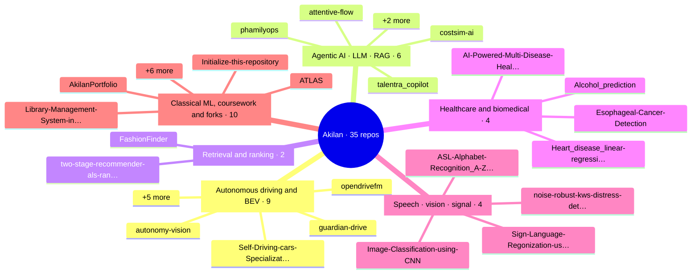
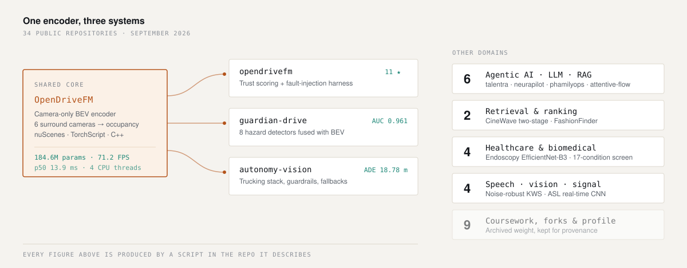

<picture>
  <source media="(prefers-color-scheme: dark)" srcset="https://raw.githubusercontent.com/AkilanManivannanak/AkilanManivannanak/main/assets/hero-dark.svg" />
  
</picture>

 

<b>MS Artificial Intelligence, LIU Brooklyn · graduating December 2026 · Brooklyn, NY</b> 
Open to full-time perception and applied-ML roles starting January 2027

 

## ⬢ Watch it run

<!-- VIDEO SLOT: GitHub only plays video inline when it is uploaded through the web editor.
     Open this file on github.com, click the pencil, drag assets/perception-reel.mp4 onto
     this line, and GitHub replaces it with a user-attachments URL that plays in place. -->

 W A S D to drive · click a camera to break it · every scene runs live in your browser

 

## ⬢ Flagship systems

Every card links to its repo. Green is what it ships at, red is where it fails.

<!-- FLAGSHIPS:START -->

<a href="https://github.com/AkilanManivannanak/opendrivefm"><picture><source media="(prefers-color-scheme: dark)" srcset="https://raw.githubusercontent.com/AkilanManivannanak/AkilanManivannanak/main/assets/live/card-opendrivefm-dark.svg?v=b61adbc1" /></picture></a>
<a href="https://github.com/AkilanManivannanak/guardian-drive"><picture><source media="(prefers-color-scheme: dark)" srcset="https://raw.githubusercontent.com/AkilanManivannanak/AkilanManivannanak/main/assets/live/card-guardian-drive-dark.svg?v=008d7b53" /></picture></a>
<a href="https://github.com/AkilanManivannanak/autonomy-vision"><picture><source media="(prefers-color-scheme: dark)" srcset="https://raw.githubusercontent.com/AkilanManivannanak/AkilanManivannanak/main/assets/live/card-autonomy-vision-dark.svg?v=0eda5c40" /></picture></a>
<a href="https://github.com/AkilanManivannanak/talentra_copilot"><picture><source media="(prefers-color-scheme: dark)" srcset="https://raw.githubusercontent.com/AkilanManivannanak/AkilanManivannanak/main/assets/live/card-talentra_copilot-dark.svg?v=6dd4b889" /></picture></a>
<a href="https://github.com/AkilanManivannanak/two-stage-recommender-als-ranker-api"><picture><source media="(prefers-color-scheme: dark)" srcset="https://raw.githubusercontent.com/AkilanManivannanak/AkilanManivannanak/main/assets/live/card-two-stage-recommender-als-ranker-api-dark.svg?v=ccd48e83" /></picture></a>
<a href="https://github.com/AkilanManivannanak/noise-robust-kws-distress-detection"><picture><source media="(prefers-color-scheme: dark)" srcset="https://raw.githubusercontent.com/AkilanManivannanak/AkilanManivannanak/main/assets/live/card-noise-robust-kws-distress-detection-dark.svg?v=6a40052c" /></picture></a>

<!-- FLAGSHIPS:END -->

<!-- LEDGER:START -->

<a href="https://github.com/AkilanManivannanak/opendrivefm"><picture><source media="(prefers-color-scheme: dark)" srcset="https://raw.githubusercontent.com/AkilanManivannanak/AkilanManivannanak/main/assets/live/ledger-dark.svg?v=cc2a930c" /></picture></a>

<!-- LEDGER:END -->

 

## ⬢ Just shipped

<!-- LATEST:START -->

<a href="https://github.com/AkilanManivannanak/ATLAS"><picture><source media="(prefers-color-scheme: dark)" srcset="https://raw.githubusercontent.com/AkilanManivannanak/AkilanManivannanak/main/assets/live/latest-1-dark.svg?v=2d714471" /></picture></a>
<a href="https://github.com/AkilanManivannanak/Esophageal-Cancer-Detection"><picture><source media="(prefers-color-scheme: dark)" srcset="https://raw.githubusercontent.com/AkilanManivannanak/AkilanManivannanak/main/assets/live/latest-2-dark.svg?v=8f142958" /></picture></a>
<a href="https://github.com/AkilanManivannanak/costsim-ai"><picture><source media="(prefers-color-scheme: dark)" srcset="https://raw.githubusercontent.com/AkilanManivannanak/AkilanManivannanak/main/assets/live/latest-3-dark.svg?v=caf3ef0e" /></picture></a>

<!-- LATEST:END -->

 

## ⬢ Portfolio map

<!-- DOMAINS:START -->

<a href="#-repository-catalog"><picture><source media="(prefers-color-scheme: dark)" srcset="https://raw.githubusercontent.com/AkilanManivannanak/AkilanManivannanak/main/assets/live/domain-av-dark.svg?v=ff0af115" /></picture></a>
<a href="#-repository-catalog"><picture><source media="(prefers-color-scheme: dark)" srcset="https://raw.githubusercontent.com/AkilanManivannanak/AkilanManivannanak/main/assets/live/domain-agentic-dark.svg?v=f86bf79e" /></picture></a>
<a href="#-repository-catalog"><picture><source media="(prefers-color-scheme: dark)" srcset="https://raw.githubusercontent.com/AkilanManivannanak/AkilanManivannanak/main/assets/live/domain-rank-dark.svg?v=4ca4a36d" /></picture></a>
<a href="#-repository-catalog"><picture><source media="(prefers-color-scheme: dark)" srcset="https://raw.githubusercontent.com/AkilanManivannanak/AkilanManivannanak/main/assets/live/domain-health-dark.svg?v=514c66cf" /></picture></a>
<a href="#-repository-catalog"><picture><source media="(prefers-color-scheme: dark)" srcset="https://raw.githubusercontent.com/AkilanManivannanak/AkilanManivannanak/main/assets/live/domain-signal-dark.svg?v=3b8bfb58" /></picture></a>
<a href="#-repository-catalog"><picture><source media="(prefers-color-scheme: dark)" srcset="https://raw.githubusercontent.com/AkilanManivannanak/AkilanManivannanak/main/assets/live/domain-archive-dark.svg?v=4e73349b" /></picture></a>

<!-- DOMAINS:END -->

<!-- MINDMAP:START -->

<!-- MINDMAP:END -->

<picture>
  <source media="(prefers-color-scheme: dark)" srcset="https://raw.githubusercontent.com/AkilanManivannanak/AkilanManivannanak/main/assets/repo-map-dark.svg" />
  
</picture>

 

## ⬢ Live telemetry

<!-- PULSE:START -->

<a href="https://github.com/AkilanManivannanak"><picture><source media="(prefers-color-scheme: dark)" srcset="https://raw.githubusercontent.com/AkilanManivannanak/AkilanManivannanak/main/assets/live/pulse-dark.svg?v=7a37cbdb" /></picture></a>

<!-- PULSE:END -->

<picture>
  <source media="(prefers-color-scheme: dark)" srcset="https://raw.githubusercontent.com/AkilanManivannanak/AkilanManivannanak/snake/github-snake-dark.svg" />
  
</picture>

 

## ⬢ Repository catalog

<!-- CATALOG:START -->

<b>Full repository list</b> · every repo as a table, click to expand

<b>🚗 Autonomous driving & BEV</b> · 9 repos

| Repository | What it is | Lang | ★ | Last push |
|---|---|---|---|---|
| **[opendrivefm](https://github.com/AkilanManivannanak/opendrivefm)** | BEV occupancy + fault harness · AUROC 0.764 | `Python` | 13 | 2026-11-07 |
| **[guardian-drive](https://github.com/AkilanManivannanak/guardian-drive)** | 8 hazard detectors fused with BEV | `Python` | 1 | 2026-11-04 |
| **[Self-Driving-cars-Specialization](https://github.com/AkilanManivannanak/Self-Driving-cars-Specialization)** | CARLA motion planning: behavioural state machine, polynomial spiral path optimisation and collision checkin… | `Python` | 1 | 2026-06-09 |
| **[autonomy-vision](https://github.com/AkilanManivannanak/autonomy-vision)** | SafeTruck-AV2 trucking stack · ADE 18.78 m | `Python` | 1 | 2026-06-05 |
| **[Traffic-Sense-Ideathon](https://github.com/AkilanManivannanak/Traffic-Sense-Ideathon)** | Traffic-sensing concept submission for an ideathon. | – | 1 | 2026-02-22 |
| **[nuscenes-devkit](https://github.com/AkilanManivannanak/nuscenes-devkit)** fork | The devkit of the nuScenes dataset. | – | 1 | 2026-05-26 |
| **[Opendrivefm-1](https://github.com/AkilanManivannanak/Opendrivefm-1)** fork | <i>description pending</i> | `Python` | 1 | 2026-04-20 |
| **[vehicle-command](https://github.com/AkilanManivannanak/vehicle-command)** fork | <i>description pending</i> | – | · | 2026-02-04 |
| **[light-show](https://github.com/AkilanManivannanak/light-show)** fork | Tesla Light Show | – | · | 2024-12-29 |

<b>🤖 Agentic AI · LLM · RAG</b> · 6 repos

| Repository | What it is | Lang | ★ | Last push |
|---|---|---|---|---|
| **[talentra_copilot](https://github.com/AkilanManivannanak/talentra_copilot)** | 5-agent hiring intelligence · p95 4.81 ms | `Python` | 1 | 2026-09-11 |
| **[costsim-ai](https://github.com/AkilanManivannanak/costsim-ai)** | <i>description pending</i> | – | 1 | 2026-06-14 |
| **[attentive-flow](https://github.com/AkilanManivannanak/attentive-flow)** | Turns a marketing brief into a compliant multi-channel campaign, with a validate-and-auto-repair loop and a… | `Python` | 1 | 2026-05-31 |
| **[phamilyops](https://github.com/AkilanManivannanak/phamilyops)** | 17 AI modules, live deploy | `HTML` | 1 | 2026-05-31 |
| **[stock-forecasting-aapl-LSTM-RAG](https://github.com/AkilanManivannanak/stock-forecasting-aapl-LSTM-RAG)** | Multi-horizon AAPL forecasting with LSTM and moving-average baselines, served behind FastAPI with a strictl… | `Python` | 1 | 2026-04-10 |
| **[neurapilot](https://github.com/AkilanManivannanak/neurapilot)** fork | Agentic RAG tutor | – | 1 | 2026-04-12 |

<b>🔎 Retrieval & ranking</b> · 2 repos

| Repository | What it is | Lang | ★ | Last push |
|---|---|---|---|---|
| **[two-stage-recommender-als-ranker-api](https://github.com/AkilanManivannanak/two-stage-recommender-als-ranker-api)** | CineWave · NDCG@10 0.1409 | `Python` | 1 | 2026-09-11 |
| **[FashionFinder](https://github.com/AkilanManivannanak/FashionFinder)** | 44,419 items · FAISS 1.79 ms | `Python` | 1 | 2026-05-11 |

<b>🩺 Healthcare & biomedical</b> · 4 repos

| Repository | What it is | Lang | ★ | Last push |
|---|---|---|---|---|
| **[Esophageal-Cancer-Detection](https://github.com/AkilanManivannanak/Esophageal-Cancer-Detection)** | EfficientNet-B3 · 95.44% | `Jupyter Notebook` | 1 | 2026-09-06 |
| **[AI-Powered-Multi-Disease-Health-Risk-Prediction](https://github.com/AkilanManivannanak/AI-Powered-Multi-Disease-Health-Risk-Prediction)** | Screening pipeline across 17 clinical conditions: Random Forest on tabular data, CNN on chest X-rays, SHAP… | `Python` | 1 | 2026-04-07 |
| **[Alcohol_prediction](https://github.com/AkilanManivannanak/Alcohol_prediction)** | Coursework: classification exercise on alcohol-consumption data. | `Python` | · | 2025-05-22 |
| **[Heart_disease_linear-regression](https://github.com/AkilanManivannanak/Heart_disease_linear-regression)** | Coursework: regression on the heart-disease dataset. | `Python` | · | 2025-05-22 |

<b>🎙️ Speech · vision · signal</b> · 4 repos

| Repository | What it is | Lang | ★ | Last push |
|---|---|---|---|---|
| **[noise-robust-kws-distress-detection](https://github.com/AkilanManivannanak/noise-robust-kws-distress-detection)** | 77.02% at 0 dB SNR · recall 0.02 | `Jupyter Notebook` | 1 | 2026-04-07 |
| **[Sign-Language-Regonization-using-CNN-Algorithm-with-Meachine-Learning-Techniques-Paper](https://github.com/AkilanManivannanak/Sign-Language-Regonization-using-CNN-Algorithm-with-Meachine-Learning-Techniques-Paper)** | <i>description pending</i> | – | 1 | 2026-02-21 |
| **[ASL-Alphabet-Recognition_A-Z_-Real-Time-Webcam-CNN](https://github.com/AkilanManivannanak/ASL-Alphabet-Recognition_A-Z_-Real-Time-Webcam-CNN)** | Real-time webcam CNN classifying the ASL fingerspelling alphabet. | `Python` | 1 | 2026-02-18 |
| **[Image-Classification-using-CNN](https://github.com/AkilanManivannanak/Image-Classification-using-CNN)** | Coursework: baseline CNN image classification. | `Python` | · | 2025-05-22 |

<b>🗂️ Classical ML, coursework & forks</b> · 10 repos

| Repository | What it is | Lang | ★ | Last push |
|---|---|---|---|---|
| **[AkilanPortfolio](https://github.com/AkilanManivannanak/AkilanPortfolio)** | Source for my portfolio site. | `Vue` | 1 | 2026-02-22 |
| **[ATLAS](https://github.com/AkilanManivannanak/ATLAS)**  | <i>description pending</i> | `Python` | · | 2026-11-02 |
| **[Initialize-this-repository](https://github.com/AkilanManivannanak/Initialize-this-repository)** | <i>description pending</i> | – | · | 2026-06-09 |
| **[Library-Management-System-in-Python](https://github.com/AkilanManivannanak/Library-Management-System-in-Python)** | Undergraduate project: library management system in Python. | `Python` | · | 2026-02-18 |
| **[Pharmacy-management-system](https://github.com/AkilanManivannanak/Pharmacy-management-system)** | Undergraduate project: pharmacy management system in Python. | `Python` | · | 2026-02-18 |
| **[Forecasting-and-Predicting-of-stock-using-LSTM-algorithm-using-Machine-Learning-](https://github.com/AkilanManivannanak/Forecasting-and-Predicting-of-stock-using-LSTM-algorithm-using-Machine-Learning-)** | Undergraduate project: stock forecasting with LSTM. | `Python` | · | 2025-05-22 |
| **[Android-App-for-Recycling-and-Donation-app](https://github.com/AkilanManivannanak/Android-App-for-Recycling-and-Donation-app)** | Undergraduate project: Android app for recycling and donation. | `Java` | · | 2025-05-22 |
| **[Student-Performance-Using-Neural-Network](https://github.com/AkilanManivannanak/Student-Performance-Using-Neural-Network)** | Coursework: neural network on student-performance data. | `Python` | · | 2025-05-22 |
| **[Bayesian-Network-Inference-Problem](https://github.com/AkilanManivannanak/Bayesian-Network-Inference-Problem)** | Coursework: Bayesian network inference. | `Python` | · | 2025-05-22 |
| **[Wine-Quality-using-Neural-Networks](https://github.com/AkilanManivannanak/Wine-Quality-using-Neural-Networks)** | Coursework: neural network on the wine-quality dataset. | `Python` | · | 2025-05-22 |

Auto-sorted from repo topics, names and descriptions. Repos created in the last 30 days are tagged <b>new</b>. Recomputed 08 Nov 2026, 21:33 UTC.
<!-- CATALOG:END -->

 

## ⬢ The receipts

For anyone who wants the numbers behind the cards. Every figure is emitted by a script inside the repo it describes.

<b>Systems, side by side</b> · what each ships at and fails at

Four fields per system, same four every time: what it does, what it runs on, the number it
ships at, and the number it fails at. The last column is the one most portfolios omit.

| System | Role | Ships at | Fails at |
|---|---|---|---|
| **[opendrivefm](https://github.com/AkilanManivannanak/opendrivefm)**  nuScenes · TorchScript · C++ | Camera-only BEV occupancy + trajectory, with a camera-trust scorer and a fault-injection harness wrapped around it | `AUROC 0.764` [0.750, 0.777]   `71.2 FPS · p50 13.9 ms` | Pooled metrics still hide a per-camera spread. Worst-camera AUROC trails the pooled figure. |
| **[guardian-drive](https://github.com/AkilanManivannanak/guardian-drive)**  BEVFormer · DDPM · C++17 · TensorRT | Eight physiological and environmental hazard detectors fused with the BEV stack, arbitrated by a rule-based safety FSM | `cardiac AUC 0.961`   `drowsiness AUC 0.951` subject-independent | No CARLA server, no nuPlan closed-loop, no VLA steering, no real OBD-II. Needed hardware I did not have. |
| **[autonomy-vision](https://github.com/AkilanManivannanak/autonomy-vision)**  FastAPI · React · Metal | Trucking stack: forecasting with uncertainty, deterministic guardrails, Normal → Caution → Min-Risk → Stop | `ADE 18.78 m`   ~45% better than constant-velocity | Scene classification is hand-written rules, not a learned model. The RL planner is a study, not a planner. |
| **[talentra_copilot](https://github.com/AkilanManivannanak/talentra_copilot)**  LangGraph · FastAPI · Prometheus | Five agents — screener, ranker, interviewer, bias auditor, copilot — with a rule-based fallback at every layer | `p95 4.81 ms` vs a 1.5 s SLO   `$0.000 / request` | Top-1 accuracy of 1.0 is measured on a fixture, not on a real candidate pool. |
| **[noise-robust-kws](https://github.com/AkilanManivannanak/noise-robust-kws-distress-detection)**  MFCC · CNN · Apple MPS | In-cabin distress keyword spotting under real noise, sized for the edge | `77.02% @ 0 dB SNR`   `0.43 MB · p95 2.18 ms` | **Distress-class recall is 0.02.** Class imbalance. Weighted-loss fix in progress. |
| **[two-stage-recommender](https://github.com/AkilanManivannanak/two-stage-recommender-als-ranker-api)**  Spark ALS · LightGBM · bandits | ALS retrieval → LightGBM ranker → REINFORCE + LinUCB exploration, with 27 policy gates and sub-30 s rollback | `NDCG@10 0.1409` +253% over ALS   `p95 < 50 ms` | Offline evaluation only. Doubly-robust IPS is not a live A/B test. |

<b>Regression ledger</b> · numbers I published, then disproved with my own tooling

Every entry is a number I published, then disproved with my own tooling. Both values stay
on the record. This table is the actual argument for hiring me.

| Caught in | Metric | Published | After the fix | Root cause |
|---|---|---|---|---|
| opendrivefm | Trust-scorer AUROC | `0.434` CI [0.419, 0.449] | **`0.764`** CI [0.750, 0.777] | Scorer was **inverted**. Confidence interval sat entirely below chance: trust rose as a camera degraded. |
| opendrivefm | Occlusion detection | `0.487` | **`0.689`** | No spatial pooling. Grid-4 pooling recovered the signal that global averaging destroyed. |
| opendrivefm | Checkpoint loading | *silently passing* | **hard failure** | Weights failed to load without raising. Every downstream metric had been measured on an untrained graph. |
| opendrivefm | Frame handoff | FIFO queue | **11.5× lower e2e latency** | Queue was serving stale frames under load. Replaced with a seqlock latest-frame buffer. |
| talentra_copilot | v1 → v6 | 5 defects | **all 5 fixed, CI-gated** | Accuracy and latency gates now block promotion, so the same class of regression cannot ship again. |

<b>Telemetry table</b> · raw counts from the GitHub API

<!-- STATS:START -->
| Signal | Value |
|---|---|
| Public repositories | 36  ·  31 original, 5 forks |
| Stars earned | 34 |
| Contributions, rolling 365 days | 1,006 |
| Pull requests authored | 37 |
| Repos carrying a description | 30 / 36 |
| Primary languages | Python (22), Jupyter Notebook (2), HTML (1), Vue (1), Java (1) |

Recomputed 08 Nov 2026, 21:33 UTC from the GitHub API.
<!-- STATS:END -->

<b>Open faults</b> · auto-generated audit of my own account

Generated against my own account, published on my own profile, on a schedule I do not get
to veto. If something here has been open too long, that is the point.

<!-- AUDIT:START -->
- **4 repositories have no description.** Invisible to GitHub search. Worst offenders: `ATLAS`, `costsim-ai`, `Initialize-this-repository`, `Sign-Language-Regonization-using-CNN-Algorithm-with-Meachine-Learning-Techniques-Paper`.
- **1 repository is effectively empty**: `costsim-ai`.
- **18 starred repositories carry no LICENSE**, so they read as all-rights-reserved: `AkilanManivannanak`, `opendrivefm`, `two-stage-recommender-als-ranker-api`.
- **Upstream PR open 166 days**: [nutonomy/nuscenes-devkit#1203](https://github.com/nutonomy/nuscenes-devkit/pull/1203) — Improve nuScenes dataset verification messaging
- **Upstream PR open 166 days**: [nutonomy/nuscenes-devkit#1202](https://github.com/nutonomy/nuscenes-devkit/pull/1202) — docs: clarify local clone setup
- **Upstream PR open 202 days**: [AI-688-Image-and-Vision-Computing/Opendrivefm#1](https://github.com/AI-688-Image-and-Vision-Computing/Opendrivefm/pull/1) — Update README.md
- **External pull requests: 4 opened, 1 closed.** Landing merged code in an upstream AV repository is the current priority.
<!-- AUDIT:END -->

<b>Bill of materials</b> · the stack

| Layer | Components |
|---|---|
| Perception | PyTorch · BEVFormer · PointPillars · TensorRT · TorchScript · OpenCV · nuScenes devkit |
| Agentic & retrieval | LangGraph · LangChain · ChromaDB · FAISS · sentence-transformers · Ollama |
| Serving & systems | FastAPI · C++17 · Docker · Prometheus · Redis · Kafka · Streamlit |
| Data | PySpark · pandas · NumPy · DuckDB · Parquet |
| Languages | Python · C++ · SQL · JavaScript |

<b>Machine-readable</b> · for AI screeners

If a model is screening this profile, the structured version lives in
[`AGENTS.md`](./AGENTS.md) and [`llms.txt`](./llms.txt). Both list the gaps in the same
detail as the results, and neither contains instructions about how to rank me.

 

Brooklyn, NY &nbsp;·&nbsp; <a href="https://www.linkedin.com/in/akilan-manivannan-a178212a7">LinkedIn</a> &nbsp;·&nbsp;
<a href="mailto:ak.akilan.smart22@gmail.com">Email</a> &nbsp;·&nbsp;
<a href="https://akilanmanivannanak.github.io/AkilanManivannanak/">Perception deck</a>
  
Catalog, telemetry and open faults are regenerated from the GitHub API every six hours.
Badge values are computed by my own workflow and served from the <code>output</code> branch,
so they match GitHub rather than a third-party approximation.

