

<picture>
  <source media="(prefers-color-scheme: dark)" srcset="https://raw.githubusercontent.com/AkilanManivannanak/AkilanManivannanak/main/assets/hero-dark.svg" />
  
</picture>

<!-- HEADER:START -->

<a href="https://akilanmanivannanak.github.io/AkilanManivannanak/"><picture><source media="(prefers-color-scheme: dark)" srcset="https://raw.githubusercontent.com/AkilanManivannanak/AkilanManivannanak/main/assets/live/headline-dark.svg?v=f6617134" /></picture></a> 
<a href="https://github.com/AkilanManivannanak?tab=repositories"><picture><source media="(prefers-color-scheme: dark)" srcset="https://raw.githubusercontent.com/AkilanManivannanak/AkilanManivannanak/main/assets/live/stats-dark.svg?v=81b666e2" /></picture></a>

<!-- HEADER:END -->

<b>MS Artificial Intelligence, LIU Brooklyn · graduating December 2026 · Brooklyn, NY</b> 
Open to full-time perception and applied-ML roles starting January 2027

 

## ⬢ Watch it run

<!-- VIDEO SLOT: GitHub only plays video inline when it is uploaded through the web editor.
     Open this file on github.com, click the pencil, drag assets/perception-reel.mp4 onto
     this line, and GitHub replaces it with a user-attachments URL that plays in place. -->

<a href="https://akilanmanivannanak.github.io/AkilanManivannanak/">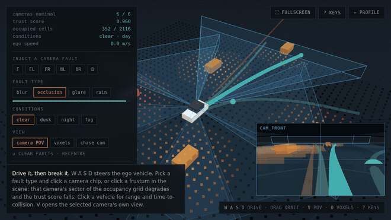</a>

<a href="https://akilanmanivannanak.github.io/AkilanManivannanak/">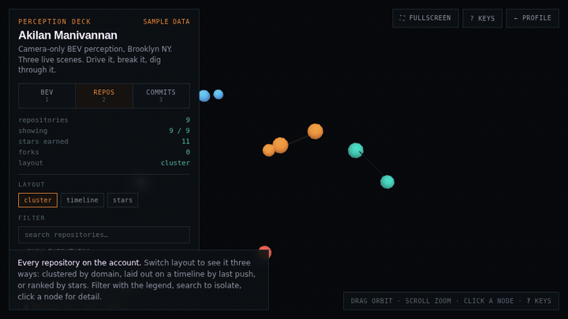</a>
<a href="https://akilanmanivannanak.github.io/AkilanManivannanak/">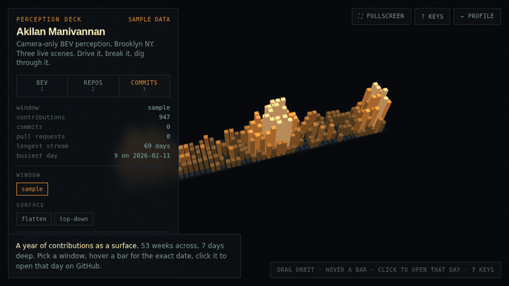</a>

<!-- DRIVE:START -->

<a href="https://akilanmanivannanak.github.io/AkilanManivannanak/"><picture><source media="(prefers-color-scheme: dark)" srcset="https://raw.githubusercontent.com/AkilanManivannanak/AkilanManivannanak/main/assets/live/drive-dark.svg?v=c2a71d01" />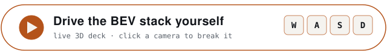</picture></a>

<!-- DRIVE:END -->

 

## ⬢ Flagship systems

Every card opens its repository. Each one shows its system the way it actually works.

<!-- FLAGSHIPS:START -->

<a href="https://github.com/AkilanManivannanak/opendrivefm"><picture><source media="(prefers-color-scheme: dark)" srcset="https://raw.githubusercontent.com/AkilanManivannanak/AkilanManivannanak/main/assets/live/flag-opendrivefm-dark.svg?v=ece502f2" /></picture></a>
<a href="https://github.com/AkilanManivannanak/guardian-drive"><picture><source media="(prefers-color-scheme: dark)" srcset="https://raw.githubusercontent.com/AkilanManivannanak/AkilanManivannanak/main/assets/live/flag-guardian-drive-dark.svg?v=82874b61" /></picture></a>
<a href="https://github.com/AkilanManivannanak/autonomy-vision"><picture><source media="(prefers-color-scheme: dark)" srcset="https://raw.githubusercontent.com/AkilanManivannanak/AkilanManivannanak/main/assets/live/flag-autonomy-vision-dark.svg?v=08f7041a" /></picture></a>
<a href="https://github.com/AkilanManivannanak/talentra_copilot"><picture><source media="(prefers-color-scheme: dark)" srcset="https://raw.githubusercontent.com/AkilanManivannanak/AkilanManivannanak/main/assets/live/flag-talentra_copilot-dark.svg?v=2a372626" /></picture></a>
<a href="https://github.com/AkilanManivannanak/two-stage-recommender-als-ranker-api"><picture><source media="(prefers-color-scheme: dark)" srcset="https://raw.githubusercontent.com/AkilanManivannanak/AkilanManivannanak/main/assets/live/flag-two-stage-recommender-als-ranker-api-dark.svg?v=edc997b8" /></picture></a>
<a href="https://github.com/AkilanManivannanak/noise-robust-kws-distress-detection"><picture><source media="(prefers-color-scheme: dark)" srcset="https://raw.githubusercontent.com/AkilanManivannanak/AkilanManivannanak/main/assets/live/flag-noise-robust-kws-distress-detection-dark.svg?v=f37b04b1" /></picture></a>

<!-- FLAGSHIPS:END -->

<!-- LEDGER:START -->

<a href="https://github.com/AkilanManivannanak/opendrivefm"><picture><source media="(prefers-color-scheme: dark)" srcset="https://raw.githubusercontent.com/AkilanManivannanak/AkilanManivannanak/main/assets/live/ledger-dark.svg?v=b775a5a4" />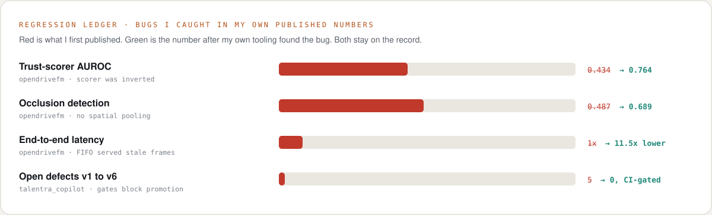</picture></a>

<!-- LEDGER:END -->

 

## ⬢ Just shipped

<!-- LATEST:START -->

<a href="https://github.com/AkilanManivannanak/AuthOps"><picture><source media="(prefers-color-scheme: dark)" srcset="https://raw.githubusercontent.com/AkilanManivannanak/AkilanManivannanak/main/assets/live/latest-1-dark.svg?v=15daa406" /></picture></a>
<a href="https://github.com/AkilanManivannanak/ATLAS"><picture><source media="(prefers-color-scheme: dark)" srcset="https://raw.githubusercontent.com/AkilanManivannanak/AkilanManivannanak/main/assets/live/latest-2-dark.svg?v=0901f7d3" /></picture></a>
<a href="https://github.com/AkilanManivannanak/Esophageal-Cancer-Detection"><picture><source media="(prefers-color-scheme: dark)" srcset="https://raw.githubusercontent.com/AkilanManivannanak/AkilanManivannanak/main/assets/live/latest-3-dark.svg?v=faaf1496" /></picture></a>

<!-- LATEST:END -->

 

## ⬢ Portfolio map

<!-- DOMAINS:START -->

<a href="#-every-repository"><picture><source media="(prefers-color-scheme: dark)" srcset="https://raw.githubusercontent.com/AkilanManivannanak/AkilanManivannanak/main/assets/live/domain-av-dark.svg?v=bac3ddc9" /></picture></a>
<a href="#-every-repository"><picture><source media="(prefers-color-scheme: dark)" srcset="https://raw.githubusercontent.com/AkilanManivannanak/AkilanManivannanak/main/assets/live/domain-agentic-dark.svg?v=f0b52be8" /></picture></a>
<a href="#-every-repository"><picture><source media="(prefers-color-scheme: dark)" srcset="https://raw.githubusercontent.com/AkilanManivannanak/AkilanManivannanak/main/assets/live/domain-rank-dark.svg?v=fbc3aabe" /></picture></a>
<a href="#-every-repository"><picture><source media="(prefers-color-scheme: dark)" srcset="https://raw.githubusercontent.com/AkilanManivannanak/AkilanManivannanak/main/assets/live/domain-health-dark.svg?v=530397c0" /></picture></a>
<a href="#-every-repository"><picture><source media="(prefers-color-scheme: dark)" srcset="https://raw.githubusercontent.com/AkilanManivannanak/AkilanManivannanak/main/assets/live/domain-signal-dark.svg?v=097480ed" /></picture></a>
<a href="#-every-repository"><picture><source media="(prefers-color-scheme: dark)" srcset="https://raw.githubusercontent.com/AkilanManivannanak/AkilanManivannanak/main/assets/live/domain-finance-dark.svg?v=83515adf" /></picture></a>
<a href="#-every-repository"><picture><source media="(prefers-color-scheme: dark)" srcset="https://raw.githubusercontent.com/AkilanManivannanak/AkilanManivannanak/main/assets/live/domain-ml-dark.svg?v=88bfb7a0" /></picture></a>
<a href="#-every-repository"><picture><source media="(prefers-color-scheme: dark)" srcset="https://raw.githubusercontent.com/AkilanManivannanak/AkilanManivannanak/main/assets/live/domain-apps-dark.svg?v=f3ab6469" /></picture></a>
<a href="#-every-repository"><picture><source media="(prefers-color-scheme: dark)" srcset="https://raw.githubusercontent.com/AkilanManivannanak/AkilanManivannanak/main/assets/live/domain-forks-dark.svg?v=e756c523" /></picture></a>

<!-- DOMAINS:END -->

<!-- MINDMAP:START -->
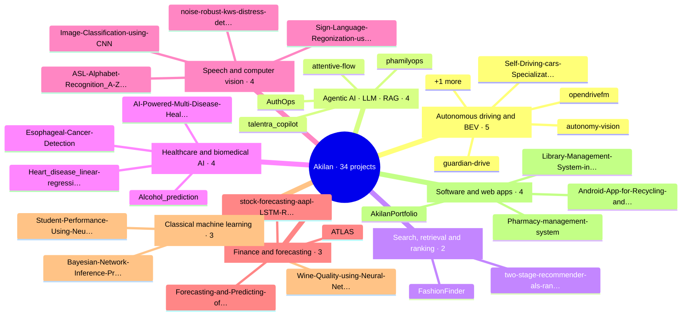
<!-- MINDMAP:END -->

 

## ⬢ Live telemetry

<!-- PULSE:START -->

<a href="https://github.com/AkilanManivannanak"><picture><source media="(prefers-color-scheme: dark)" srcset="https://raw.githubusercontent.com/AkilanManivannanak/AkilanManivannanak/main/assets/live/pulse-dark.svg?v=ea2a0751" /></picture></a>

<!-- PULSE:END -->

<!-- CITY:START -->

<a href="https://github.com/AkilanManivannanak"><picture><source media="(prefers-color-scheme: dark)" srcset="https://raw.githubusercontent.com/AkilanManivannanak/AkilanManivannanak/main/assets/live/contrib-city-dark.svg?v=bd748dd8" /></picture></a>

<!-- CITY:END -->

<picture>
  <source media="(prefers-color-scheme: dark)" srcset="https://raw.githubusercontent.com/AkilanManivannanak/AkilanManivannanak/snake/github-snake-dark.svg" />
  
</picture>

 

## ⬢ Every repository

<!-- CATALOG:START -->

<a href="https://akilanmanivannanak.github.io/AkilanManivannanak/repos.html"><picture><source media="(prefers-color-scheme: dark)" srcset="https://raw.githubusercontent.com/AkilanManivannanak/AkilanManivannanak/main/assets/live/explore-dark.svg?v=9e32caed" /></picture></a>

<a href="https://akilanmanivannanak.github.io/AkilanManivannanak/repos.html#cat=av"><picture><source media="(prefers-color-scheme: dark)" srcset="https://raw.githubusercontent.com/AkilanManivannanak/AkilanManivannanak/main/assets/live/section-av-dark.svg?v=34ffb194" /></picture></a>

<a href="https://github.com/AkilanManivannanak/opendrivefm"><picture><source media="(prefers-color-scheme: dark)" srcset="https://raw.githubusercontent.com/AkilanManivannanak/AkilanManivannanak/main/assets/live/repo-opendrivefm-dark.svg?v=8351edb3" /></picture></a>
<a href="https://github.com/AkilanManivannanak/guardian-drive"><picture><source media="(prefers-color-scheme: dark)" srcset="https://raw.githubusercontent.com/AkilanManivannanak/AkilanManivannanak/main/assets/live/repo-guardian-drive-dark.svg?v=1ed8edfc" /></picture></a>
<a href="https://github.com/AkilanManivannanak/Self-Driving-cars-Specialization"><picture><source media="(prefers-color-scheme: dark)" srcset="https://raw.githubusercontent.com/AkilanManivannanak/AkilanManivannanak/main/assets/live/repo-self-driving-cars-specialization-dark.svg?v=e145d94b" /></picture></a>
<a href="https://github.com/AkilanManivannanak/autonomy-vision"><picture><source media="(prefers-color-scheme: dark)" srcset="https://raw.githubusercontent.com/AkilanManivannanak/AkilanManivannanak/main/assets/live/repo-autonomy-vision-dark.svg?v=94895e40" /></picture></a>
<a href="https://github.com/AkilanManivannanak/Traffic-Sense-Ideathon"><picture><source media="(prefers-color-scheme: dark)" srcset="https://raw.githubusercontent.com/AkilanManivannanak/AkilanManivannanak/main/assets/live/repo-traffic-sense-ideathon-dark.svg?v=194a82af" /></picture></a>

<a href="https://akilanmanivannanak.github.io/AkilanManivannanak/repos.html#cat=agentic"><picture><source media="(prefers-color-scheme: dark)" srcset="https://raw.githubusercontent.com/AkilanManivannanak/AkilanManivannanak/main/assets/live/section-agentic-dark.svg?v=0a9406fb" /></picture></a>

<a href="https://github.com/AkilanManivannanak/talentra_copilot"><picture><source media="(prefers-color-scheme: dark)" srcset="https://raw.githubusercontent.com/AkilanManivannanak/AkilanManivannanak/main/assets/live/repo-talentra-copilot-dark.svg?v=07cef64c" /></picture></a>
<a href="https://github.com/AkilanManivannanak/attentive-flow"><picture><source media="(prefers-color-scheme: dark)" srcset="https://raw.githubusercontent.com/AkilanManivannanak/AkilanManivannanak/main/assets/live/repo-attentive-flow-dark.svg?v=4ac60b58" /></picture></a>
<a href="https://github.com/AkilanManivannanak/phamilyops"><picture><source media="(prefers-color-scheme: dark)" srcset="https://raw.githubusercontent.com/AkilanManivannanak/AkilanManivannanak/main/assets/live/repo-phamilyops-dark.svg?v=381905a5" /></picture></a>
<a href="https://github.com/AkilanManivannanak/AuthOps"><picture><source media="(prefers-color-scheme: dark)" srcset="https://raw.githubusercontent.com/AkilanManivannanak/AkilanManivannanak/main/assets/live/repo-authops-dark.svg?v=ada929ca" /></picture></a>

<a href="https://akilanmanivannanak.github.io/AkilanManivannanak/repos.html#cat=rank"><picture><source media="(prefers-color-scheme: dark)" srcset="https://raw.githubusercontent.com/AkilanManivannanak/AkilanManivannanak/main/assets/live/section-rank-dark.svg?v=0701dd3b" /></picture></a>

<a href="https://github.com/AkilanManivannanak/FashionFinder"><picture><source media="(prefers-color-scheme: dark)" srcset="https://raw.githubusercontent.com/AkilanManivannanak/AkilanManivannanak/main/assets/live/repo-fashionfinder-dark.svg?v=469640b5" /></picture></a>
<a href="https://github.com/AkilanManivannanak/two-stage-recommender-als-ranker-api"><picture><source media="(prefers-color-scheme: dark)" srcset="https://raw.githubusercontent.com/AkilanManivannanak/AkilanManivannanak/main/assets/live/repo-two-stage-recommender-als-ranker-api-dark.svg?v=3df19353" /></picture></a>

<a href="https://akilanmanivannanak.github.io/AkilanManivannanak/repos.html#cat=health"><picture><source media="(prefers-color-scheme: dark)" srcset="https://raw.githubusercontent.com/AkilanManivannanak/AkilanManivannanak/main/assets/live/section-health-dark.svg?v=689fddd3" /></picture></a>

<a href="https://github.com/AkilanManivannanak/Esophageal-Cancer-Detection"><picture><source media="(prefers-color-scheme: dark)" srcset="https://raw.githubusercontent.com/AkilanManivannanak/AkilanManivannanak/main/assets/live/repo-esophageal-cancer-detection-dark.svg?v=d562d183" /></picture></a>
<a href="https://github.com/AkilanManivannanak/AI-Powered-Multi-Disease-Health-Risk-Prediction"><picture><source media="(prefers-color-scheme: dark)" srcset="https://raw.githubusercontent.com/AkilanManivannanak/AkilanManivannanak/main/assets/live/repo-ai-powered-multi-disease-health-risk-prediction-dark.svg?v=1fe98937" /></picture></a>
<a href="https://github.com/AkilanManivannanak/Alcohol_prediction"><picture><source media="(prefers-color-scheme: dark)" srcset="https://raw.githubusercontent.com/AkilanManivannanak/AkilanManivannanak/main/assets/live/repo-alcohol-prediction-dark.svg?v=d16b0c4e" /></picture></a>
<a href="https://github.com/AkilanManivannanak/Heart_disease_linear-regression"><picture><source media="(prefers-color-scheme: dark)" srcset="https://raw.githubusercontent.com/AkilanManivannanak/AkilanManivannanak/main/assets/live/repo-heart-disease-linear-regression-dark.svg?v=f32c4a5b" /></picture></a>

<a href="https://akilanmanivannanak.github.io/AkilanManivannanak/repos.html#cat=signal"><picture><source media="(prefers-color-scheme: dark)" srcset="https://raw.githubusercontent.com/AkilanManivannanak/AkilanManivannanak/main/assets/live/section-signal-dark.svg?v=82fea453" /></picture></a>

<a href="https://github.com/AkilanManivannanak/ASL-Alphabet-Recognition_A-Z_-Real-Time-Webcam-CNN"><picture><source media="(prefers-color-scheme: dark)" srcset="https://raw.githubusercontent.com/AkilanManivannanak/AkilanManivannanak/main/assets/live/repo-asl-alphabet-recognition-a-z-real-time-webcam-cnn-dark.svg?v=cc215754" /></picture></a>
<a href="https://github.com/AkilanManivannanak/noise-robust-kws-distress-detection"><picture><source media="(prefers-color-scheme: dark)" srcset="https://raw.githubusercontent.com/AkilanManivannanak/AkilanManivannanak/main/assets/live/repo-noise-robust-kws-distress-detection-dark.svg?v=98b2c6ba" /></picture></a>
<a href="https://github.com/AkilanManivannanak/Sign-Language-Regonization-using-CNN-Algorithm-with-Meachine-Learning-Techniques-Paper"><picture><source media="(prefers-color-scheme: dark)" srcset="https://raw.githubusercontent.com/AkilanManivannanak/AkilanManivannanak/main/assets/live/repo-sign-language-regonization-using-cnn-algorithm-with-meachine-dark.svg?v=1d085cd4" /></picture></a>
<a href="https://github.com/AkilanManivannanak/Image-Classification-using-CNN"><picture><source media="(prefers-color-scheme: dark)" srcset="https://raw.githubusercontent.com/AkilanManivannanak/AkilanManivannanak/main/assets/live/repo-image-classification-using-cnn-dark.svg?v=bf4e1ddd" /></picture></a>

<a href="https://akilanmanivannanak.github.io/AkilanManivannanak/repos.html#cat=finance"><picture><source media="(prefers-color-scheme: dark)" srcset="https://raw.githubusercontent.com/AkilanManivannanak/AkilanManivannanak/main/assets/live/section-finance-dark.svg?v=845e8e12" /></picture></a>

<a href="https://github.com/AkilanManivannanak/stock-forecasting-aapl-LSTM-RAG"><picture><source media="(prefers-color-scheme: dark)" srcset="https://raw.githubusercontent.com/AkilanManivannanak/AkilanManivannanak/main/assets/live/repo-stock-forecasting-aapl-lstm-rag-dark.svg?v=6b609df8" /></picture></a>
<a href="https://github.com/AkilanManivannanak/ATLAS"><picture><source media="(prefers-color-scheme: dark)" srcset="https://raw.githubusercontent.com/AkilanManivannanak/AkilanManivannanak/main/assets/live/repo-atlas-dark.svg?v=c4210b6a" /></picture></a>
<a href="https://github.com/AkilanManivannanak/Forecasting-and-Predicting-of-stock-using-LSTM-algorithm-using-Machine-Learning-"><picture><source media="(prefers-color-scheme: dark)" srcset="https://raw.githubusercontent.com/AkilanManivannanak/AkilanManivannanak/main/assets/live/repo-forecasting-and-predicting-of-stock-using-lstm-algorithm-usi-dark.svg?v=2eff10d9" /></picture></a>

<a href="https://akilanmanivannanak.github.io/AkilanManivannanak/repos.html#cat=ml"><picture><source media="(prefers-color-scheme: dark)" srcset="https://raw.githubusercontent.com/AkilanManivannanak/AkilanManivannanak/main/assets/live/section-ml-dark.svg?v=15b189ee" /></picture></a>

<a href="https://github.com/AkilanManivannanak/Student-Performance-Using-Neural-Network"><picture><source media="(prefers-color-scheme: dark)" srcset="https://raw.githubusercontent.com/AkilanManivannanak/AkilanManivannanak/main/assets/live/repo-student-performance-using-neural-network-dark.svg?v=2f9852d6" /></picture></a>
<a href="https://github.com/AkilanManivannanak/Bayesian-Network-Inference-Problem"><picture><source media="(prefers-color-scheme: dark)" srcset="https://raw.githubusercontent.com/AkilanManivannanak/AkilanManivannanak/main/assets/live/repo-bayesian-network-inference-problem-dark.svg?v=c97969b0" /></picture></a>
<a href="https://github.com/AkilanManivannanak/Wine-Quality-using-Neural-Networks"><picture><source media="(prefers-color-scheme: dark)" srcset="https://raw.githubusercontent.com/AkilanManivannanak/AkilanManivannanak/main/assets/live/repo-wine-quality-using-neural-networks-dark.svg?v=b99d812c" /></picture></a>

<a href="https://akilanmanivannanak.github.io/AkilanManivannanak/repos.html#cat=apps"><picture><source media="(prefers-color-scheme: dark)" srcset="https://raw.githubusercontent.com/AkilanManivannanak/AkilanManivannanak/main/assets/live/section-apps-dark.svg?v=257be628" /></picture></a>

<a href="https://github.com/AkilanManivannanak/AkilanPortfolio"><picture><source media="(prefers-color-scheme: dark)" srcset="https://raw.githubusercontent.com/AkilanManivannanak/AkilanManivannanak/main/assets/live/repo-akilanportfolio-dark.svg?v=7cc38a27" /></picture></a>
<a href="https://github.com/AkilanManivannanak/Library-Management-System-in-Python"><picture><source media="(prefers-color-scheme: dark)" srcset="https://raw.githubusercontent.com/AkilanManivannanak/AkilanManivannanak/main/assets/live/repo-library-management-system-in-python-dark.svg?v=4701978d" /></picture></a>
<a href="https://github.com/AkilanManivannanak/Pharmacy-management-system"><picture><source media="(prefers-color-scheme: dark)" srcset="https://raw.githubusercontent.com/AkilanManivannanak/AkilanManivannanak/main/assets/live/repo-pharmacy-management-system-dark.svg?v=6c9e1e3c" /></picture></a>
<a href="https://github.com/AkilanManivannanak/Android-App-for-Recycling-and-Donation-app"><picture><source media="(prefers-color-scheme: dark)" srcset="https://raw.githubusercontent.com/AkilanManivannanak/AkilanManivannanak/main/assets/live/repo-android-app-for-recycling-and-donation-app-dark.svg?v=8e45f05a" /></picture></a>

<a href="https://akilanmanivannanak.github.io/AkilanManivannanak/repos.html#cat=forks"><picture><source media="(prefers-color-scheme: dark)" srcset="https://raw.githubusercontent.com/AkilanManivannanak/AkilanManivannanak/main/assets/live/section-forks-dark.svg?v=b22dd734" /></picture></a>

<a href="https://github.com/AkilanManivannanak/nuscenes-devkit"><picture><source media="(prefers-color-scheme: dark)" srcset="https://raw.githubusercontent.com/AkilanManivannanak/AkilanManivannanak/main/assets/live/repo-nuscenes-devkit-dark.svg?v=baacce49" /></picture></a>
<a href="https://github.com/AkilanManivannanak/Opendrivefm-1"><picture><source media="(prefers-color-scheme: dark)" srcset="https://raw.githubusercontent.com/AkilanManivannanak/AkilanManivannanak/main/assets/live/repo-opendrivefm-1-dark.svg?v=1076aa76" /></picture></a>
<a href="https://github.com/AkilanManivannanak/neurapilot"><picture><source media="(prefers-color-scheme: dark)" srcset="https://raw.githubusercontent.com/AkilanManivannanak/AkilanManivannanak/main/assets/live/repo-neurapilot-dark.svg?v=5c8f38df" /></picture></a>
<a href="https://github.com/AkilanManivannanak/vehicle-command"><picture><source media="(prefers-color-scheme: dark)" srcset="https://raw.githubusercontent.com/AkilanManivannanak/AkilanManivannanak/main/assets/live/repo-vehicle-command-dark.svg?v=ef197ca9" /></picture></a>
<a href="https://github.com/AkilanManivannanak/light-show"><picture><source media="(prefers-color-scheme: dark)" srcset="https://raw.githubusercontent.com/AkilanManivannanak/AkilanManivannanak/main/assets/live/repo-light-show-dark.svg?v=516330b7" /></picture></a>

Every card opens its repository. Sorted automatically from each repo's topics, description and README; new repositories appear here within six hours. Recomputed 21 Nov 2026, 19:49 UTC.

<!-- CATALOG:END -->

 

## ⬢ Systems at a glance

| System | What it does | Built with | Headline results |
|---|---|---|---|
| **[OpenDriveFM](https://github.com/AkilanManivannanak/opendrivefm)** | Camera-only BEV occupancy and 6 s trajectory prediction with per-camera trust scoring and a fault-injection harness | PyTorch · nuScenes · TorchScript · C++ | Fault AUROC **0.764** [0.750, 0.777] · **71.2 FPS** · p50 13.9 ms |
| **[Guardian Drive](https://github.com/AkilanManivannanak/guardian-drive)** | Eight physiological and environmental hazard detectors fused with BEV perception, arbitrated by a safety state machine | BEVFormer · DDPM · C++17 · TensorRT | Cardiac AUC **0.961** · drowsiness AUC **0.951** · nuScenes ADE **3.159 m** |
| **[SafeTruck-AV2](https://github.com/AkilanManivannanak/autonomy-vision)** | Autonomous trucking prototype: BEV perception, uncertainty-aware forecasting, guardrails, Normal to Min-Risk fallback | FastAPI · React · Metal | ADE **18.78 m**, about **45%** better than constant velocity |
| **[Talentra Copilot](https://github.com/AkilanManivannanak/talentra_copilot)** | Five-agent hiring platform: screener, ranker, interviewer, bias auditor, copilot | LangGraph · FastAPI · Prometheus | p95 **4.81 ms** against a 1.5 s SLO · **$0.000** per request |
| **[CineWave](https://github.com/AkilanManivannanak/two-stage-recommender-als-ranker-api)** | ALS retrieval, LightGBM ranker, REINFORCE and LinUCB exploration, 27 policy gates | Spark ALS · LightGBM · GraphQL | NDCG@10 **0.1409**, **+253%** over ALS · p95 under 50 ms |
| **[Noise-Robust KWS](https://github.com/AkilanManivannanak/noise-robust-kws-distress-detection)** | In-cabin distress keyword spotting under real noise, sized for the edge | MFCC · CNN · PyTorch | **88.4%** clean · **77.0%** at 0 dB SNR · **0.43 MB** · p95 2.18 ms |

 

## ⬢ Account telemetry

<!-- STATS:START -->
| Signal | Value |
|---|---|
| Public repositories | 37  ·  32 original, 5 forks |
| Stars earned | 34 |
| Contributions, rolling 365 days | 1,230 |
| Pull requests authored | 76 |
| Repos carrying a description | 34 / 37 |
| Primary languages | Python (23), Jupyter Notebook (2), HTML (1), Vue (1), Java (1) |

Recomputed 21 Nov 2026, 19:49 UTC from the GitHub API.
<!-- STATS:END -->

 

## ⬢ Stack

| Layer | Components |
|---|---|
| Perception | PyTorch · BEVFormer · PointPillars · TensorRT · TorchScript · OpenCV · nuScenes devkit |
| Agentic & retrieval | LangGraph · LangChain · ChromaDB · FAISS · sentence-transformers · Ollama |
| Serving & systems | FastAPI · C++17 · Docker · Prometheus · Redis · Kafka · Streamlit |
| Data | PySpark · pandas · NumPy · DuckDB · Parquet |
| Languages | Python · C++ · SQL · JavaScript |

Structured versions of this profile for automated screeners: [`AGENTS.md`](./AGENTS.md) and [`llms.txt`](./llms.txt).

 

Brooklyn, NY &nbsp;·&nbsp; <a href="https://www.linkedin.com/in/akilan-manivannan-a178212a7">LinkedIn</a> &nbsp;·&nbsp;
<a href="mailto:ak.akilan.smart22@gmail.com">Email</a> &nbsp;·&nbsp;
<a href="https://akilanmanivannanak.github.io/AkilanManivannanak/">Perception deck</a>
  
Cards, catalog and telemetry are regenerated from the GitHub API every six hours.
New repositories are categorised and added automatically.

