

<picture>
  <source media="(prefers-color-scheme: dark)" srcset="https://raw.githubusercontent.com/AkilanManivannanak/AkilanManivannanak/main/assets/hero-dark.svg" />
  
</picture>

<!-- HEADER:START -->

<a href="https://akilanmanivannanak.github.io/AkilanManivannanak/"><picture><source media="(prefers-color-scheme: dark)" srcset="https://raw.githubusercontent.com/AkilanManivannanak/AkilanManivannanak/main/assets/live/headline-dark.svg?v=f6617134" /></picture></a> 
<a href="https://github.com/AkilanManivannanak?tab=repositories"><picture><source media="(prefers-color-scheme: dark)" srcset="https://raw.githubusercontent.com/AkilanManivannanak/AkilanManivannanak/main/assets/live/stats-dark.svg?v=f7a6352f" /></picture></a>

<!-- HEADER:END -->

<b>MS Artificial Intelligence, LIU Brooklyn · graduating December 2026 · Brooklyn, NY</b> 
Open to full-time perception and applied-ML roles starting January 2027

 

## ⬢ Watch it run

<!-- VIDEO SLOT: GitHub only plays video inline when it is uploaded through the web editor.
     Open this file on github.com, click the pencil, drag assets/perception-reel.mp4 onto
     this line, and GitHub replaces it with a user-attachments URL that plays in place. -->

<a href="https://akilanmanivannanak.github.io/AkilanManivannanak/">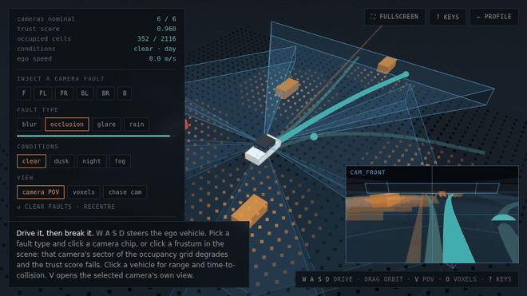</a>

<a href="https://akilanmanivannanak.github.io/AkilanManivannanak/">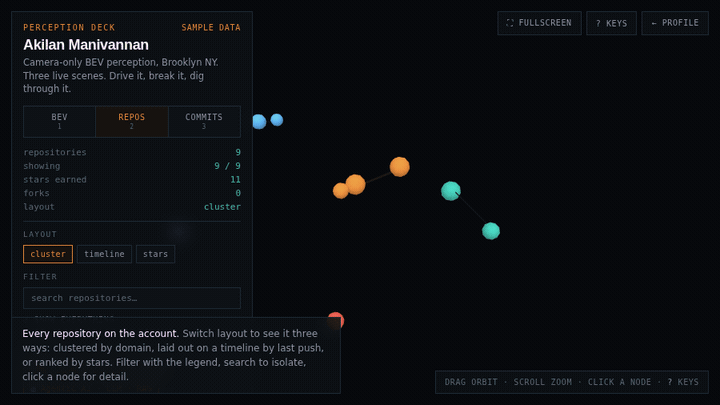</a>
<a href="https://akilanmanivannanak.github.io/AkilanManivannanak/">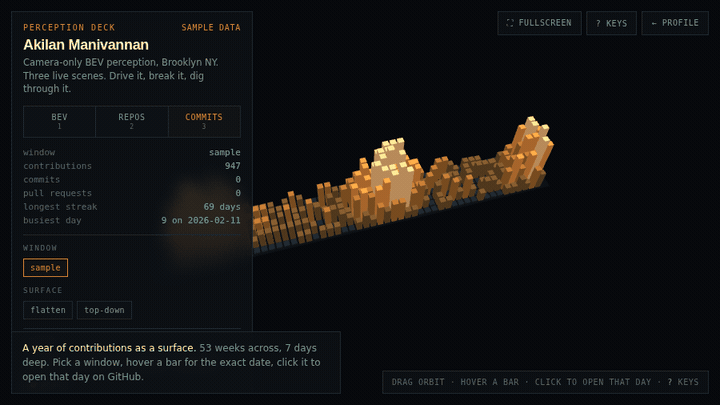</a>

<!-- DRIVE:START -->

<a href="https://akilanmanivannanak.github.io/AkilanManivannanak/"><picture><source media="(prefers-color-scheme: dark)" srcset="https://raw.githubusercontent.com/AkilanManivannanak/AkilanManivannanak/main/assets/live/drive-dark.svg?v=c2a71d01" />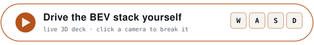</picture></a>

<!-- DRIVE:END -->

 

## ⬢ Flagship systems

Every card opens its repository. Each gauge fills to the system's headline metric.

<!-- FLAGSHIPS:START -->

<a href="https://github.com/AkilanManivannanak/opendrivefm"><picture><source media="(prefers-color-scheme: dark)" srcset="https://raw.githubusercontent.com/AkilanManivannanak/AkilanManivannanak/main/assets/live/card-opendrivefm-dark.svg?v=8cffbaa2" /></picture></a>
<a href="https://github.com/AkilanManivannanak/guardian-drive"><picture><source media="(prefers-color-scheme: dark)" srcset="https://raw.githubusercontent.com/AkilanManivannanak/AkilanManivannanak/main/assets/live/card-guardian-drive-dark.svg?v=ac44a9b4" /></picture></a>
<a href="https://github.com/AkilanManivannanak/autonomy-vision"><picture><source media="(prefers-color-scheme: dark)" srcset="https://raw.githubusercontent.com/AkilanManivannanak/AkilanManivannanak/main/assets/live/card-autonomy-vision-dark.svg?v=dae2a8b6" /></picture></a>
<a href="https://github.com/AkilanManivannanak/talentra_copilot"><picture><source media="(prefers-color-scheme: dark)" srcset="https://raw.githubusercontent.com/AkilanManivannanak/AkilanManivannanak/main/assets/live/card-talentra_copilot-dark.svg?v=c5f74981" /></picture></a>
<a href="https://github.com/AkilanManivannanak/two-stage-recommender-als-ranker-api"><picture><source media="(prefers-color-scheme: dark)" srcset="https://raw.githubusercontent.com/AkilanManivannanak/AkilanManivannanak/main/assets/live/card-two-stage-recommender-als-ranker-api-dark.svg?v=1560cb9c" /></picture></a>
<a href="https://github.com/AkilanManivannanak/noise-robust-kws-distress-detection"><picture><source media="(prefers-color-scheme: dark)" srcset="https://raw.githubusercontent.com/AkilanManivannanak/AkilanManivannanak/main/assets/live/card-noise-robust-kws-distress-detection-dark.svg?v=e11fc67e" /></picture></a>

<!-- FLAGSHIPS:END -->

<!-- LEDGER:START -->

<a href="https://github.com/AkilanManivannanak/opendrivefm"><picture><source media="(prefers-color-scheme: dark)" srcset="https://raw.githubusercontent.com/AkilanManivannanak/AkilanManivannanak/main/assets/live/ledger-dark.svg?v=b775a5a4" />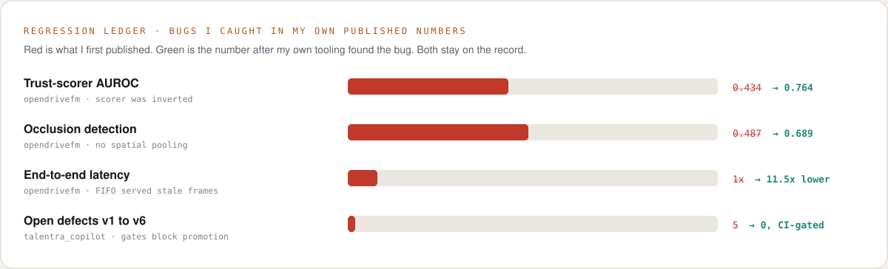</picture></a>

<!-- LEDGER:END -->

 

## ⬢ Just shipped

<!-- LATEST:START -->

<a href="https://github.com/AkilanManivannanak/ATLAS"><picture><source media="(prefers-color-scheme: dark)" srcset="https://raw.githubusercontent.com/AkilanManivannanak/AkilanManivannanak/main/assets/live/latest-1-dark.svg?v=15c2593d" /></picture></a>
<a href="https://github.com/AkilanManivannanak/Esophageal-Cancer-Detection"><picture><source media="(prefers-color-scheme: dark)" srcset="https://raw.githubusercontent.com/AkilanManivannanak/AkilanManivannanak/main/assets/live/latest-2-dark.svg?v=0e08362d" /></picture></a>
<a href="https://github.com/AkilanManivannanak/Self-Driving-cars-Specialization"><picture><source media="(prefers-color-scheme: dark)" srcset="https://raw.githubusercontent.com/AkilanManivannanak/AkilanManivannanak/main/assets/live/latest-3-dark.svg?v=c30914b0" /></picture></a>

<!-- LATEST:END -->

 

## ⬢ Portfolio map

<!-- DOMAINS:START -->

<a href="#-every-repository"><picture><source media="(prefers-color-scheme: dark)" srcset="https://raw.githubusercontent.com/AkilanManivannanak/AkilanManivannanak/main/assets/live/domain-av-dark.svg?v=f15e46e3" /></picture></a>
<a href="#-every-repository"><picture><source media="(prefers-color-scheme: dark)" srcset="https://raw.githubusercontent.com/AkilanManivannanak/AkilanManivannanak/main/assets/live/domain-agentic-dark.svg?v=e0394227" /></picture></a>
<a href="#-every-repository"><picture><source media="(prefers-color-scheme: dark)" srcset="https://raw.githubusercontent.com/AkilanManivannanak/AkilanManivannanak/main/assets/live/domain-rank-dark.svg?v=cec7d1d8" /></picture></a>
<a href="#-every-repository"><picture><source media="(prefers-color-scheme: dark)" srcset="https://raw.githubusercontent.com/AkilanManivannanak/AkilanManivannanak/main/assets/live/domain-health-dark.svg?v=61cd669e" /></picture></a>
<a href="#-every-repository"><picture><source media="(prefers-color-scheme: dark)" srcset="https://raw.githubusercontent.com/AkilanManivannanak/AkilanManivannanak/main/assets/live/domain-signal-dark.svg?v=a4eabdf7" /></picture></a>
<a href="#-every-repository"><picture><source media="(prefers-color-scheme: dark)" srcset="https://raw.githubusercontent.com/AkilanManivannanak/AkilanManivannanak/main/assets/live/domain-finance-dark.svg?v=40cc425f" /></picture></a>
<a href="#-every-repository"><picture><source media="(prefers-color-scheme: dark)" srcset="https://raw.githubusercontent.com/AkilanManivannanak/AkilanManivannanak/main/assets/live/domain-ml-dark.svg?v=50881ab1" /></picture></a>
<a href="#-every-repository"><picture><source media="(prefers-color-scheme: dark)" srcset="https://raw.githubusercontent.com/AkilanManivannanak/AkilanManivannanak/main/assets/live/domain-apps-dark.svg?v=9085fc4b" /></picture></a>
<a href="#-every-repository"><picture><source media="(prefers-color-scheme: dark)" srcset="https://raw.githubusercontent.com/AkilanManivannanak/AkilanManivannanak/main/assets/live/domain-forks-dark.svg?v=6352c85a" /></picture></a>

<!-- DOMAINS:END -->

<!-- MINDMAP:START -->
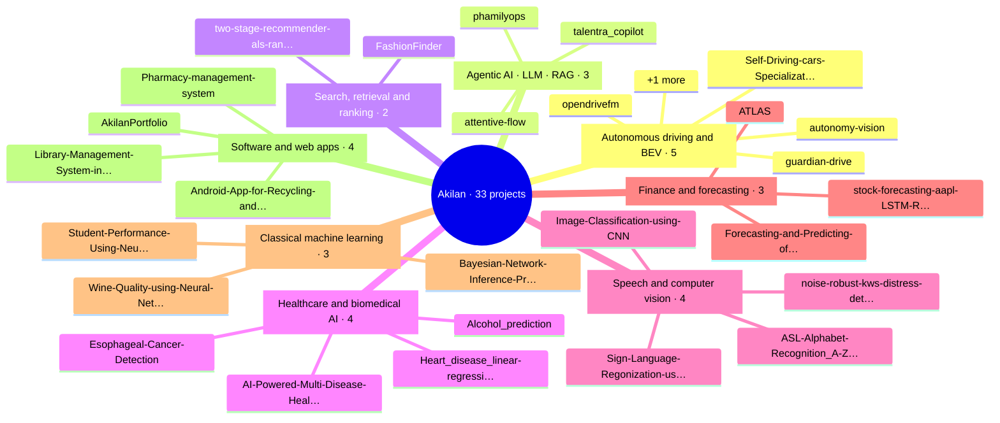
<!-- MINDMAP:END -->

 

## ⬢ Live telemetry

<!-- PULSE:START -->

<a href="https://github.com/AkilanManivannanak"><picture><source media="(prefers-color-scheme: dark)" srcset="https://raw.githubusercontent.com/AkilanManivannanak/AkilanManivannanak/main/assets/live/pulse-dark.svg?v=23ca6e20" /></picture></a>

<!-- PULSE:END -->

<picture>
  <source media="(prefers-color-scheme: dark)" srcset="https://raw.githubusercontent.com/AkilanManivannanak/AkilanManivannanak/snake/github-snake-dark.svg" />
  
</picture>

 

## ⬢ Every repository

<!-- CATALOG:START -->
#### 🚗 Autonomous driving & BEV · 5 repos

| Repository | What it is | Built with | Updated |
|---|---|---|---|
| **[opendrivefm](https://github.com/AkilanManivannanak/opendrivefm)** ★ 13 | Camera-only BEV occupancy and 6 s trajectory prediction on nuScenes with per-camera trust scoring. Fault AUROC 0.764 at 71.2 FPS. | PyTorch · nuScenes · C++ | Nov 2026 |
| **[guardian-drive](https://github.com/AkilanManivannanak/guardian-drive)** ★ 1 | Driver-safety stack: eight hazard detectors fused with BEV perception under a safety state machine. Cardiac AUC 0.961. | BEVFormer · TensorRT · C++17 | Nov 2026 |
| **[Self-Driving-cars-Specialization](https://github.com/AkilanManivannanak/Self-Driving-cars-Specialization)** ★ 1 | Full CARLA motion-planning stack: behavioural planner, polynomial spiral paths, collision checking and velocity profiles. | Python · CARLA | Jun 2026 |
| **[autonomy-vision](https://github.com/AkilanManivannanak/autonomy-vision)** ★ 1 | SafeTruck-AV2: autonomous trucking prototype with BEV perception, uncertainty-aware forecasting and safety guardrails. ADE 18.78 m. | FastAPI · React · nuScenes | Jun 2026 |
| **[Traffic-Sense-Ideathon](https://github.com/AkilanManivannanak/Traffic-Sense-Ideathon)** ★ 1 | TrafficSense: forecasts congestion 5 to 15 minutes ahead and turns it into constraint-aware adaptive signal timing. | ML · smart-city pitch | Feb 2026 |

#### 🤖 Agentic AI · LLM · RAG · 3 repos

| Repository | What it is | Built with | Updated |
|---|---|---|---|
| **[talentra_copilot](https://github.com/AkilanManivannanak/talentra_copilot)** ★ 1 | Compound AI hiring platform: five LangGraph agents with semantic retrieval, PII redaction and fallbacks. p95 4.81 ms. | LangGraph · FastAPI · Prometheus | Sep 2026 |
| **[attentive-flow](https://github.com/AkilanManivannanak/attentive-flow)** ★ 1 | AttentiveFlow: agentic lifecycle marketing, from brief to audience, messages, compliance checks, scoring and auto-repair. | LLM agents · Streamlit | May 2026 |
| **[phamilyops](https://github.com/AkilanManivannanak/phamilyops)** ★ 1 | AI-native care operations platform: HR workflow automation plus a RAG copilot over Supabase and pgvector. | Claude API · FastAPI · pgvector | May 2026 |

#### 🔎 Search, retrieval & ranking · 2 repos

| Repository | What it is | Built with | Updated |
|---|---|---|---|
| **[two-stage-recommender-als-ranker-api](https://github.com/AkilanManivannanak/two-stage-recommender-als-ranker-api)** ★ 1 | CineWave: ALS retrieval plus a LightGBM LambdaRank ranker with bandit exploration. NDCG@10 0.1409, +253% over ALS. | Spark ALS · LightGBM · GraphQL | Sep 2026 |
| **[FashionFinder](https://github.com/AkilanManivannanak/FashionFinder)** ★ 1 | Visual search for fashion: CLIP and ResNet18 embeddings indexed in FAISS for Pinterest-style similarity search. Live demo. | CLIP · FAISS · PyTorch | May 2026 |

#### 🩺 Healthcare & biomedical AI · 4 repos

| Repository | What it is | Built with | Updated |
|---|---|---|---|
| **[Esophageal-Cancer-Detection](https://github.com/AkilanManivannanak/Esophageal-Cancer-Detection)** ★ 1 | Multi-task EfficientNet-B3 that flags gastrointestinal abnormalities in endoscopy images in real time. | EfficientNet-B3 · PyTorch | Sep 2026 |
| **[AI-Powered-Multi-Disease-Health-Risk-Prediction](https://github.com/AkilanManivannanak/AI-Powered-Multi-Disease-Health-Risk-Prediction)** ★ 1 | Screens 17 chronic and genetic conditions from clinical data and chest X-rays. 87.3% average test accuracy. | EfficientNetB0 · TensorFlow | Apr 2026 |
| **[Alcohol_prediction](https://github.com/AkilanManivannanak/Alcohol_prediction)** | Predicts alcohol use from personality and demographic traits on the UCI drug-consumption data with XGBoost and random forests. | XGBoost · scikit-learn | May 2025 |
| **[Heart_disease_linear-regression](https://github.com/AkilanManivannanak/Heart_disease_linear-regression)** | Heart-disease prediction with PCA and logistic regression on clinical features. | scikit-learn | May 2025 |

#### 🎙️ Speech & computer vision · 4 repos

| Repository | What it is | Built with | Updated |
|---|---|---|---|
| **[noise-robust-kws-distress-detection](https://github.com/AkilanManivannanak/noise-robust-kws-distress-detection)** ★ 1 | Distress keyword spotting in noisy cabin audio. 77.0% accuracy at 0 dB SNR from a 0.43 MB model. | MFCC · CNN · PyTorch | Apr 2026 |
| **[Sign-Language-Regonization-using-CNN-Algorithm-with-Meachine-Learning-Techniques-Paper](https://github.com/AkilanManivannanak/Sign-Language-Regonization-using-CNN-Algorithm-with-Meachine-Learning-Techniques-Paper)** ★ 1 | Research paper: a CNN and LSTM pipeline that translates sign-language video into text and audio. | Research paper | Feb 2026 |
| **[ASL-Alphabet-Recognition_A-Z_-Real-Time-Webcam-CNN](https://github.com/AkilanManivannanak/ASL-Alphabet-Recognition_A-Z_-Real-Time-Webcam-CNN)** ★ 1 | Real-time ASL fingerspelling recognition, A to Z, from a webcam feed. | TensorFlow · OpenCV | Feb 2026 |
| **[Image-Classification-using-CNN](https://github.com/AkilanManivannanak/Image-Classification-using-CNN)** | CNN image classifier trained on CIFAR-10. | TensorFlow · Keras | May 2025 |

#### 📈 Finance & forecasting · 3 repos

| Repository | What it is | Built with | Updated |
|---|---|---|---|
| **[stock-forecasting-aapl-LSTM-RAG](https://github.com/AkilanManivannanak/stock-forecasting-aapl-LSTM-RAG)** ★ 1 | AAPL forecasting with LSTM and baselines, plus a strictly grounded RAG copilot. MAPE 3.34%, 0% hallucination. | LSTM · ChromaDB · FastAPI | Apr 2026 |
| **[ATLAS](https://github.com/AkilanManivannanak/ATLAS)** <kbd>new</kbd> | ATLAS-Σ: research simulator for financial infrastructure, modelling institutions, payment obligations, settlement and disruptions. | Python 3.12 | Nov 2026 |
| **[Forecasting-and-Predicting-of-stock-using-LSTM-algorithm-using-Machine-Learning-](https://github.com/AkilanManivannanak/Forecasting-and-Predicting-of-stock-using-LSTM-algorithm-using-Machine-Learning-)** | Stock-price forecasting with an LSTM network. | LSTM · Python | May 2025 |

#### 🧮 Classical machine learning · 3 repos

| Repository | What it is | Built with | Updated |
|---|---|---|---|
| **[Student-Performance-Using-Neural-Network](https://github.com/AkilanManivannanak/Student-Performance-Using-Neural-Network)** | Neural-network classifier that predicts student performance bands. | TensorFlow · Keras | May 2025 |
| **[Bayesian-Network-Inference-Problem](https://github.com/AkilanManivannanak/Bayesian-Network-Inference-Problem)** | Bayesian network with exact inference by variable elimination. | pgmpy | May 2025 |
| **[Wine-Quality-using-Neural-Networks](https://github.com/AkilanManivannanak/Wine-Quality-using-Neural-Networks)** | Neural network written from scratch in NumPy that grades red-wine quality on the UCI dataset. | NumPy | May 2025 |

#### 🧩 Software & web apps · 4 repos

| Repository | What it is | Built with | Updated |
|---|---|---|---|
| **[AkilanPortfolio](https://github.com/AkilanManivannanak/AkilanPortfolio)** ★ 1 | AkilanFlix: Netflix-style AI/ML portfolio site with live search, carousels and a built-in chatbot. | Nuxt · TypeScript · Tailwind | Feb 2026 |
| **[Library-Management-System-in-Python](https://github.com/AkilanManivannanak/Library-Management-System-in-Python)** | Library management CLI with multi-copy inventory, borrowers and loans. | Python · SQLite | Feb 2026 |
| **[Pharmacy-management-system](https://github.com/AkilanManivannanak/Pharmacy-management-system)** | Pharmacy operations system: inventory, suppliers, sales and prescriptions through a CLI and a FastAPI REST API. | Python · SQLite · FastAPI | Feb 2026 |
| **[Android-App-for-Recycling-and-Donation-app](https://github.com/AkilanManivannanak/Android-App-for-Recycling-and-Donation-app)** | Android app that connects people with recycling centres and donation drives. | Java · Android | May 2025 |

#### 🍴 Open-source forks · 5 repos

| Repository | What it is | Built with | Updated |
|---|---|---|---|
| **[nuscenes-devkit](https://github.com/AkilanManivannanak/nuscenes-devkit)** ★ 1 | Fork of the nuScenes devkit, used across the BEV perception work. | Python · nuScenes | May 2026 |
| **[Opendrivefm-1](https://github.com/AkilanManivannanak/Opendrivefm-1)** ★ 1 | Mirror of OpenDriveFM, the camera-only BEV perception system. | PyTorch · nuScenes | Apr 2026 |
| **[neurapilot](https://github.com/AkilanManivannanak/neurapilot)** ★ 1 | NeuraPilot: compound AI tutor with LangGraph routing, semantic caching and observability. | LangGraph · Ollama | Apr 2026 |
| **[vehicle-command](https://github.com/AkilanManivannanak/vehicle-command)** | Fork of Tesla's Vehicle Command SDK for authenticated vehicle commands. | Go | Feb 2026 |
| **[light-show](https://github.com/AkilanManivannanak/light-show)** | Fork of Tesla's light-show guide for custom xLights shows on Tesla vehicles. | xLights | Dec 2024 |

Sorted automatically from each repo's topics, description and README. Repos created in the last 30 days are tagged <b>new</b>. Recomputed 10 Nov 2026, 20:00 UTC.
<!-- CATALOG:END -->

 

## ⬢ Systems at a glance

| System | What it does | Built with | Headline results |
|---|---|---|---|
| **[OpenDriveFM](https://github.com/AkilanManivannanak/opendrivefm)** | Camera-only BEV occupancy and 6 s trajectory prediction with per-camera trust scoring and a fault-injection harness | PyTorch · nuScenes · TorchScript · C++ | Fault AUROC **0.764** [0.750, 0.777] · **71.2 FPS** · p50 13.9 ms |
| **[Guardian Drive](https://github.com/AkilanManivannanak/guardian-drive)** | Eight physiological and environmental hazard detectors fused with BEV perception, arbitrated by a safety state machine | BEVFormer · DDPM · C++17 · TensorRT | Cardiac AUC **0.961** · drowsiness AUC **0.951** · nuScenes ADE **3.159 m** |
| **[SafeTruck-AV2](https://github.com/AkilanManivannanak/autonomy-vision)** | Autonomous trucking prototype: BEV perception, uncertainty-aware forecasting, guardrails, Normal to Min-Risk fallback | FastAPI · React · Metal | ADE **18.78 m**, about **45%** better than constant velocity |
| **[Talentra Copilot](https://github.com/AkilanManivannanak/talentra_copilot)** | Five-agent hiring platform: screener, ranker, interviewer, bias auditor, copilot | LangGraph · FastAPI · Prometheus | p95 **4.81 ms** against a 1.5 s SLO · **$0.000** per request |
| **[CineWave](https://github.com/AkilanManivannanak/two-stage-recommender-als-ranker-api)** | ALS retrieval, LightGBM ranker, REINFORCE and LinUCB exploration, 27 policy gates | Spark ALS · LightGBM · GraphQL | NDCG@10 **0.1409**, **+253%** over ALS · p95 under 50 ms |
| **[Noise-Robust KWS](https://github.com/AkilanManivannanak/noise-robust-kws-distress-detection)** | In-cabin distress keyword spotting under real noise, sized for the edge | MFCC · CNN · PyTorch | **88.4%** clean · **77.0%** at 0 dB SNR · **0.43 MB** · p95 2.18 ms |

 

## ⬢ Account telemetry

<!-- STATS:START -->
| Signal | Value |
|---|---|
| Public repositories | 36  ·  31 original, 5 forks |
| Stars earned | 34 |
| Contributions, rolling 365 days | 1,019 |
| Pull requests authored | 37 |
| Repos carrying a description | 34 / 36 |
| Primary languages | Python (22), Jupyter Notebook (2), HTML (1), Vue (1), Java (1) |

Recomputed 10 Nov 2026, 20:00 UTC from the GitHub API.
<!-- STATS:END -->

 

## ⬢ Stack

| Layer | Components |
|---|---|
| Perception | PyTorch · BEVFormer · PointPillars · TensorRT · TorchScript · OpenCV · nuScenes devkit |
| Agentic & retrieval | LangGraph · LangChain · ChromaDB · FAISS · sentence-transformers · Ollama |
| Serving & systems | FastAPI · C++17 · Docker · Prometheus · Redis · Kafka · Streamlit |
| Data | PySpark · pandas · NumPy · DuckDB · Parquet |
| Languages | Python · C++ · SQL · JavaScript |

Structured versions of this profile for automated screeners: [`AGENTS.md`](./AGENTS.md) and [`llms.txt`](./llms.txt).

 

Brooklyn, NY &nbsp;·&nbsp; <a href="https://www.linkedin.com/in/akilan-manivannan-a178212a7">LinkedIn</a> &nbsp;·&nbsp;
<a href="mailto:ak.akilan.smart22@gmail.com">Email</a> &nbsp;·&nbsp;
<a href="https://akilanmanivannanak.github.io/AkilanManivannanak/">Perception deck</a>
  
Cards, catalog and telemetry are regenerated from the GitHub API every six hours.
New repositories are categorised and added automatically.

