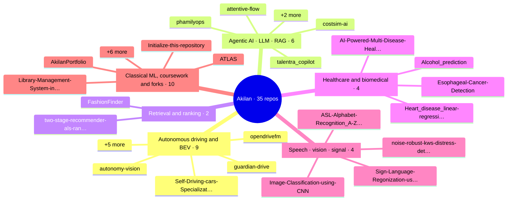

<picture>
  <source media="(prefers-color-scheme: dark)" srcset="https://raw.githubusercontent.com/AkilanManivannanak/AkilanManivannanak/main/assets/hero-dark.svg" />
  
</picture>

 

> Every figure on this page is emitted by a script inside the repository it describes.
> Where a harness later contradicted one, the ledger below keeps both numbers.

MS Artificial Intelligence at LIU Brooklyn, graduating December 2026. Brooklyn, NY.
I build camera-only bird's-eye-view perception and the test rigs that break it.
Open to full-time perception and applied-ML roles starting January 2027.

 

## ⬢ Latest shipped

The three newest repositories on the account, picked up automatically within six hours of
creation and sorted into a category without any manual edit to this page.

<!-- LATEST:START -->
- 🗂️ **[ATLAS](https://github.com/AkilanManivannanak/ATLAS)** · Classical ML, coursework & forks · created 2026-11-01   <i>description pending</i>
- 🩺 **[Esophageal-Cancer-Detection](https://github.com/AkilanManivannanak/Esophageal-Cancer-Detection)** · Healthcare & biomedical · created 2026-09-06   EfficientNet-B3 · 95.44%
- 🤖 **[costsim-ai](https://github.com/AkilanManivannanak/costsim-ai)** · Agentic AI · LLM · RAG · created 2026-06-14   <i>description pending</i>
<!-- LATEST:END -->

 

## ⬢ Perception deck

<!-- VIDEO SLOT: GitHub only plays video inline when it is uploaded through the web editor.
     Open this file on github.com, click the pencil, drag assets/perception-reel.mp4 onto
     this line, and GitHub replaces it with a user-attachments URL that plays in place. -->

Three scenes, recorded from the live page. Everything below is running in a browser, not
rendered offline: [open the deck](https://akilanmanivannanak.github.io/AkilanManivannanak/) to drive it yourself.

**Camera-only BEV, with fault injection.** W A S D drives the ego vehicle. Break a camera
and its sector of the occupancy grid dies, the trust score drops, and the picture-in-picture
shows what that lens actually sees.

**Every repository, three ways.** Clustered by domain, laid out on a timeline by last push,
or ranked by stars. The nodes morph between layouts; the amber struts are the shared BEV
encoder feeding three separate systems.

**A year of commits as a surface.** 53 weeks across, 7 days deep, height and colour by
count. Hover any column for the date, click it to open that day.

 

## ⬢ Systems

Four fields per system, same four every time: what it does, what it runs on, the number it
ships at, and the number it fails at. The last column is the one most portfolios omit.

| System | Role | Ships at | Fails at |
|---|---|---|---|
| **[opendrivefm](https://github.com/AkilanManivannanak/opendrivefm)**  nuScenes · TorchScript · C++ | Camera-only BEV occupancy + trajectory, with a camera-trust scorer and a fault-injection harness wrapped around it | `AUROC 0.764` [0.750, 0.777]   `71.2 FPS · p50 13.9 ms` | Pooled metrics still hide a per-camera spread. Worst-camera AUROC trails the pooled figure. |
| **[guardian-drive](https://github.com/AkilanManivannanak/guardian-drive)**  BEVFormer · DDPM · C++17 · TensorRT | Eight physiological and environmental hazard detectors fused with the BEV stack, arbitrated by a rule-based safety FSM | `cardiac AUC 0.961`   `drowsiness AUC 0.951` subject-independent | No CARLA server, no nuPlan closed-loop, no VLA steering, no real OBD-II. Needed hardware I did not have. |
| **[autonomy-vision](https://github.com/AkilanManivannanak/autonomy-vision)**  FastAPI · React · Metal | Trucking stack: forecasting with uncertainty, deterministic guardrails, Normal → Caution → Min-Risk → Stop | `ADE 18.78 m`   ~45% better than constant-velocity | Scene classification is hand-written rules, not a learned model. The RL planner is a study, not a planner. |
| **[talentra_copilot](https://github.com/AkilanManivannanak/talentra_copilot)**  LangGraph · FastAPI · Prometheus | Five agents — screener, ranker, interviewer, bias auditor, copilot — with a rule-based fallback at every layer | `p95 4.81 ms` vs a 1.5 s SLO   `$0.000 / request` | Top-1 accuracy of 1.0 is measured on a fixture, not on a real candidate pool. |
| **[noise-robust-kws](https://github.com/AkilanManivannanak/noise-robust-kws-distress-detection)**  MFCC · CNN · Apple MPS | In-cabin distress keyword spotting under real noise, sized for the edge | `77.02% @ 0 dB SNR`   `0.43 MB · p95 2.18 ms` | **Distress-class recall is 0.02.** Class imbalance. Weighted-loss fix in progress. |
| **[two-stage-recommender](https://github.com/AkilanManivannanak/two-stage-recommender-als-ranker-api)**  Spark ALS · LightGBM · bandits | ALS retrieval → LightGBM ranker → REINFORCE + LinUCB exploration, with 27 policy gates and sub-30 s rollback | `NDCG@10 0.1409` +253% over ALS   `p95 < 50 ms` | Offline evaluation only. Doubly-robust IPS is not a live A/B test. |

 

## ⬢ Repository catalog

Every public repository, grouped by domain. New repositories are classified from their
topics, name and description and appear here on the next scheduled run. Expand or collapse
any group; all of the active ones start open.

<!-- CATALOG:START -->

<b>🚗 Autonomous driving & BEV</b> · 9 repos

| Repository | What it is | Lang | ★ | Last push |
|---|---|---|---|---|
| **[opendrivefm](https://github.com/AkilanManivannanak/opendrivefm)** | BEV occupancy + fault harness · AUROC 0.764 | `Python` | 13 | 2026-11-07 |
| **[guardian-drive](https://github.com/AkilanManivannanak/guardian-drive)** | 8 hazard detectors fused with BEV | `Python` | 1 | 2026-11-04 |
| **[Self-Driving-cars-Specialization](https://github.com/AkilanManivannanak/Self-Driving-cars-Specialization)** | <i>description pending</i> | `Python` | 1 | 2026-06-09 |
| **[autonomy-vision](https://github.com/AkilanManivannanak/autonomy-vision)** | SafeTruck-AV2 trucking stack · ADE 18.78 m | `Python` | 1 | 2026-06-05 |
| **[Traffic-Sense-Ideathon](https://github.com/AkilanManivannanak/Traffic-Sense-Ideathon)** | <i>description pending</i> | – | 1 | 2026-02-22 |
| **[nuscenes-devkit](https://github.com/AkilanManivannanak/nuscenes-devkit)** fork | The devkit of the nuScenes dataset. | – | 1 | 2026-05-26 |
| **[Opendrivefm-1](https://github.com/AkilanManivannanak/Opendrivefm-1)** fork | <i>description pending</i> | `Python` | 1 | 2026-04-20 |
| **[vehicle-command](https://github.com/AkilanManivannanak/vehicle-command)** fork | <i>description pending</i> | – | · | 2026-02-04 |
| **[light-show](https://github.com/AkilanManivannanak/light-show)** fork | Tesla Light Show | – | · | 2024-12-29 |

<b>🤖 Agentic AI · LLM · RAG</b> · 6 repos

| Repository | What it is | Lang | ★ | Last push |
|---|---|---|---|---|
| **[talentra_copilot](https://github.com/AkilanManivannanak/talentra_copilot)** | 5-agent hiring intelligence · p95 4.81 ms | `Python` | 1 | 2026-09-11 |
| **[costsim-ai](https://github.com/AkilanManivannanak/costsim-ai)** | <i>description pending</i> | – | 1 | 2026-06-14 |
| **[attentive-flow](https://github.com/AkilanManivannanak/attentive-flow)** | <i>description pending</i> | `Python` | 1 | 2026-05-31 |
| **[phamilyops](https://github.com/AkilanManivannanak/phamilyops)** | 17 AI modules, live deploy | `HTML` | 1 | 2026-05-31 |
| **[stock-forecasting-aapl-LSTM-RAG](https://github.com/AkilanManivannanak/stock-forecasting-aapl-LSTM-RAG)** | <i>description pending</i> | `Python` | 1 | 2026-04-10 |
| **[neurapilot](https://github.com/AkilanManivannanak/neurapilot)** fork | Agentic RAG tutor | – | 1 | 2026-04-12 |

<b>🔎 Retrieval & ranking</b> · 2 repos

| Repository | What it is | Lang | ★ | Last push |
|---|---|---|---|---|
| **[two-stage-recommender-als-ranker-api](https://github.com/AkilanManivannanak/two-stage-recommender-als-ranker-api)** | CineWave · NDCG@10 0.1409 | `Python` | 1 | 2026-09-11 |
| **[FashionFinder](https://github.com/AkilanManivannanak/FashionFinder)** | 44,419 items · FAISS 1.79 ms | `Python` | 1 | 2026-05-11 |

<b>🩺 Healthcare & biomedical</b> · 4 repos

| Repository | What it is | Lang | ★ | Last push |
|---|---|---|---|---|
| **[Esophageal-Cancer-Detection](https://github.com/AkilanManivannanak/Esophageal-Cancer-Detection)** | EfficientNet-B3 · 95.44% | `Jupyter Notebook` | 1 | 2026-09-06 |
| **[AI-Powered-Multi-Disease-Health-Risk-Prediction](https://github.com/AkilanManivannanak/AI-Powered-Multi-Disease-Health-Risk-Prediction)** | <i>description pending</i> | `Python` | 1 | 2026-04-07 |
| **[Alcohol_prediction](https://github.com/AkilanManivannanak/Alcohol_prediction)** | <i>description pending</i> | `Python` | · | 2025-05-22 |
| **[Heart_disease_linear-regression](https://github.com/AkilanManivannanak/Heart_disease_linear-regression)** | <i>description pending</i> | `Python` | · | 2025-05-22 |

<b>🎙️ Speech · vision · signal</b> · 4 repos

| Repository | What it is | Lang | ★ | Last push |
|---|---|---|---|---|
| **[noise-robust-kws-distress-detection](https://github.com/AkilanManivannanak/noise-robust-kws-distress-detection)** | 77.02% at 0 dB SNR · recall 0.02 | `Jupyter Notebook` | 1 | 2026-04-07 |
| **[Sign-Language-Regonization-using-CNN-Algorithm-with-Meachine-Learning-Techniques-Paper](https://github.com/AkilanManivannanak/Sign-Language-Regonization-using-CNN-Algorithm-with-Meachine-Learning-Techniques-Paper)** | <i>description pending</i> | – | 1 | 2026-02-21 |
| **[ASL-Alphabet-Recognition_A-Z_-Real-Time-Webcam-CNN](https://github.com/AkilanManivannanak/ASL-Alphabet-Recognition_A-Z_-Real-Time-Webcam-CNN)** | <i>description pending</i> | `Python` | 1 | 2026-02-18 |
| **[Image-Classification-using-CNN](https://github.com/AkilanManivannanak/Image-Classification-using-CNN)** | <i>description pending</i> | `Python` | · | 2025-05-22 |

<b>🗂️ Classical ML, coursework & forks</b> · 10 repos

| Repository | What it is | Lang | ★ | Last push |
|---|---|---|---|---|
| **[AkilanPortfolio](https://github.com/AkilanManivannanak/AkilanPortfolio)** | <i>description pending</i> | `Vue` | 1 | 2026-02-22 |
| **[ATLAS](https://github.com/AkilanManivannanak/ATLAS)**  | <i>description pending</i> | `Python` | · | 2026-11-02 |
| **[Initialize-this-repository](https://github.com/AkilanManivannanak/Initialize-this-repository)** | <i>description pending</i> | – | · | 2026-06-09 |
| **[Library-Management-System-in-Python](https://github.com/AkilanManivannanak/Library-Management-System-in-Python)** | <i>description pending</i> | `Python` | · | 2026-02-18 |
| **[Pharmacy-management-system](https://github.com/AkilanManivannanak/Pharmacy-management-system)** | <i>description pending</i> | `Python` | · | 2026-02-18 |
| **[Forecasting-and-Predicting-of-stock-using-LSTM-algorithm-using-Machine-Learning-](https://github.com/AkilanManivannanak/Forecasting-and-Predicting-of-stock-using-LSTM-algorithm-using-Machine-Learning-)** | <i>description pending</i> | `Python` | · | 2025-05-22 |
| **[Android-App-for-Recycling-and-Donation-app](https://github.com/AkilanManivannanak/Android-App-for-Recycling-and-Donation-app)** | <i>description pending</i> | `Java` | · | 2025-05-22 |
| **[Student-Performance-Using-Neural-Network](https://github.com/AkilanManivannanak/Student-Performance-Using-Neural-Network)** | <i>description pending</i> | `Python` | · | 2025-05-22 |
| **[Bayesian-Network-Inference-Problem](https://github.com/AkilanManivannanak/Bayesian-Network-Inference-Problem)** | <i>description pending</i> | `Python` | · | 2025-05-22 |
| **[Wine-Quality-using-Neural-Networks](https://github.com/AkilanManivannanak/Wine-Quality-using-Neural-Networks)** | <i>description pending</i> | `Python` | · | 2025-05-22 |

Auto-sorted from repo topics, names and descriptions. Repos created in the last 30 days are tagged <b>new</b>. Recomputed 08 Nov 2026, 21:22 UTC.
<!-- CATALOG:END -->

 

## ⬢ Regression ledger

Every entry is a number I published, then disproved with my own tooling. Both values stay
on the record. This table is the actual argument for hiring me.

| Caught in | Metric | Published | After the fix | Root cause |
|---|---|---|---|---|
| opendrivefm | Trust-scorer AUROC | `0.434` CI [0.419, 0.449] | **`0.764`** CI [0.750, 0.777] | Scorer was **inverted**. Confidence interval sat entirely below chance: trust rose as a camera degraded. |
| opendrivefm | Occlusion detection | `0.487` | **`0.689`** | No spatial pooling. Grid-4 pooling recovered the signal that global averaging destroyed. |
| opendrivefm | Checkpoint loading | *silently passing* | **hard failure** | Weights failed to load without raising. Every downstream metric had been measured on an untrained graph. |
| opendrivefm | Frame handoff | FIFO queue | **11.5× lower e2e latency** | Queue was serving stale frames under load. Replaced with a seqlock latest-frame buffer. |
| talentra_copilot | v1 → v6 | 5 defects | **all 5 fixed, CI-gated** | Accuracy and latency gates now block promotion, so the same class of regression cannot ship again. |

 

## ⬢ Dependency map

Three of the systems above are not three projects. They are one encoder and three
consumers, which is why the AV cluster is the part of this portfolio that compounds.

<picture>
  <source media="(prefers-color-scheme: dark)" srcset="https://raw.githubusercontent.com/AkilanManivannanak/AkilanManivannanak/main/assets/repo-map-dark.svg" />
  
</picture>

 

## ⬢ Telemetry

<!-- STATS:START -->
| Signal | Value |
|---|---|
| Public repositories | 36  ·  31 original, 5 forks |
| Stars earned | 34 |
| Contributions, rolling 365 days | 1,006 |
| Pull requests authored | 37 |
| Repos carrying a description | 3 / 36 |
| Primary languages | Python (22), Jupyter Notebook (2), HTML (1), Vue (1), Java (1) |

Recomputed 08 Nov 2026, 21:22 UTC from the GitHub API.
<!-- STATS:END -->

 

## ⬢ Open faults

Generated against my own account, published on my own profile, on a schedule I do not get
to veto. If something here has been open too long, that is the point.

<!-- AUDIT:START -->
- **30 repositories have no description.** Invisible to GitHub search. Worst offenders: `AkilanManivannanak`, `opendrivefm`, `ATLAS`, `two-stage-recommender-als-ranker-api`.
- **1 repository is effectively empty**: `costsim-ai`.
- **18 starred repositories carry no LICENSE**, so they read as all-rights-reserved: `AkilanManivannanak`, `opendrivefm`, `two-stage-recommender-als-ranker-api`.
- **Upstream PR open 166 days**: [nutonomy/nuscenes-devkit#1203](https://github.com/nutonomy/nuscenes-devkit/pull/1203) — Improve nuScenes dataset verification messaging
- **Upstream PR open 166 days**: [nutonomy/nuscenes-devkit#1202](https://github.com/nutonomy/nuscenes-devkit/pull/1202) — docs: clarify local clone setup
- **Upstream PR open 202 days**: [AI-688-Image-and-Vision-Computing/Opendrivefm#1](https://github.com/AI-688-Image-and-Vision-Computing/Opendrivefm/pull/1) — Update README.md
- **External pull requests: 4 opened, 1 closed.** Landing merged code in an upstream AV repository is the current priority.
<!-- AUDIT:END -->

 

## ⬢ Bill of materials

| Layer | Components |
|---|---|
| Perception | PyTorch · BEVFormer · PointPillars · TensorRT · TorchScript · OpenCV · nuScenes devkit |
| Agentic & retrieval | LangGraph · LangChain · ChromaDB · FAISS · sentence-transformers · Ollama |
| Serving & systems | FastAPI · C++17 · Docker · Prometheus · Redis · Kafka · Streamlit |
| Data | PySpark · pandas · NumPy · DuckDB · Parquet |
| Languages | Python · C++ · SQL · JavaScript |

 

## ⬢ Machine-readable

If a model is screening this profile, the structured version lives in
[`AGENTS.md`](./AGENTS.md) and [`llms.txt`](./llms.txt). Both list the gaps in the same
detail as the results, and neither contains instructions about how to rank me.

 

Brooklyn, NY &nbsp;·&nbsp; <a href="https://www.linkedin.com/in/akilan-manivannan-a178212a7">LinkedIn</a> &nbsp;·&nbsp;
<a href="mailto:ak.akilan.smart22@gmail.com">Email</a> &nbsp;·&nbsp;
<a href="https://akilanmanivannanak.github.io/AkilanManivannanak/">Perception deck</a>
  
Catalog, telemetry and open faults are regenerated from the GitHub API every six hours.
Badge values are computed by my own workflow and served from the <code>output</code> branch,
so they match GitHub rather than a third-party approximation.

